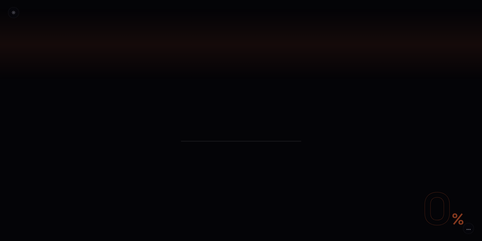

# Tarun Sisodia

**[Visit my portfolio →](https://me3.coccoder999.workers.dev/)**

Full-Stack Developer | Security-Minded Builder | Startup Execution Ready

## Opening Summary

I build backend systems, APIs, and full-stack applications designed for real user workflows with strong attention to reliability, secure logic, and scalable engineering habits. My focus is practical shipping: turning ideas into usable systems that can handle growth, debugging, and iteration.

Currently working across Node.js, JavaScript, Python, Flutter, databases, and AI-assisted development workflows.

## Portfolio

My portfolio is live at **[me3.coccoder999.workers.dev](https://me3.coccoder999.workers.dev/)** — the animated hero above is a recording of it. Click it to open the site.

## Projects

### ArenaAI / Agra SK Baghel Tour and Travels — Travel Booking Platform

Production backend for a tour & travel business: bookings, payments, and routes, built to handle real money and real users.

**Stack:** TypeScript, Fastify, Razorpay, Supabase, PostgreSQL, MongoDB, Docker, Render

### FreeTune — Music Streaming Backend

Music-streaming backend with playback, queues, and recommendations.

**Stack:** Node.js, Express, MongoDB, Redis

### CineMatch — Movie Recommendations

Movie recommendations with content-based matching.

**Stack:** React, FastAPI, Python, TF-IDF, Cosine Similarity

### WebProbe — Website Security Scanner

Authorized web-app security scanner — 136 checks, findings in seconds.

**Stack:** React, FastAPI, Python

### BloodConnect - Blood Donation Coordination Platform

Full-stack donor-recipient coordination system designed to streamline emergency blood requests, donor matching, registration workflows, and request tracking.

**Stack:** Node.js, JavaScript, NOSQL, REST APIs

### SmartCampus - Attendance Management Application

Cross-platform attendance workflow application for institutions with teacher-side management, attendance recording, and reporting logic.

**Stack:** Flutter, Node.js, DBMS

### Confession App - Privacy-First Anonymous Interaction Platform

Anonymous community posting and interaction system focused on user privacy, lightweight backend workflows, and scalable engagement logic.

**Stack:** Node.js, JavaScript, Database Design

## The Electric Gaze — in ASCII

My portrait, drawn in text. The cyan gaze line across the sunglasses is the row of `@`.

<pre>
...........::::::...............................::::::::::::::::::::::::::::::::::::::::::::::::::::
.............::::::..:::...................:::::::::::::::::::::::::::::::::::::::::::::::::::::::::
......................::::::::::::::::::::::::::::::::::::::::::::::::::::::::::::::::::::::::::::::
.........................:::::::::::::::::::::::::::::::::::::::::::::::::::::::::::::::::::::::::::
...........................:::::::::::::::::::::::::::::::::::::::::::::::::::::::::::::::::::::::::
............................::::::::::::::::::::::::::::::::::::::::::::::::::::::::::::::::::::::::
............................::::::::::::::::::::::::::::::::::::::::::::::::::::::::::::::::::::::::
.............................:::::::::::::::::::::::::::::::::::::::::::::::::::::::::::::::::::::::
..............................:::::::::::::::::::::::::::::::::::::::::-----------------------------
..............................:::::::::::::::::::::::::::::::::::-------==========================--
..............................::::::::::::::::::::::--------------========================---------:
........................::---::::::::::..........:::-------============================---:::.......
.......................:-+++=-:....................::::::---==========================--::..........
...........::::....::::-=+==-::...................:::.....::----===---=====+=========--:............
.........::-=------=--:::-:::.................:...............:::-:::::---==++++=====--:.........:::
.......:-=+****+++=-:::::::.........:::::::...............................:-=+++=====--:.......:-++*
.....:-=**####**+-:................:::::::...........................::----=+++=---==--:::::.:-=*##*
------=*######**+=:...........::::::................................-=+**++++=-::::-----=++=-=+*##*+
=+**+++*########*+-:.........::::--::...............................-=+++++=-:.....:----=*#****###*+
+*###****########*+==============++==========--:.....................:::::--:.......::::-+*********+
*#####***########***#########################*+=-:::....................................:=+++++++++=
*###***#######################################*+==-:::..............:...................:--========-
*##*++*#######***############################**++==-::::...........:::...........:....::::::--::::::
######****##**++**###########################**++++===----::..........................::......:::...
#######**++++===+*##############################***+++++===--:::..............................:::...
########**+===-=+*##%%%###########%%%%%%%%%%%%%%###**++++++====--:::::::::::::::..............:....:
#########**@@@@@@@@@@@@@@@@@@@@@@@@@@@@@@@@@@@@@@@@@@@@@@@@@@@@@@@@@@@@@@@@@@@@::..........:::....:-
+*######*+=--:::::-====---------==+++++==============+++++++++++==----===--::::::::::::....:::....:-
-=*####*+-:........::::..........:::.................:::--==+++++=-:::--:::::::::::---:...........::
===+*##*+-::......:-=-:::........::::::::--------=------+********+=----:::::::::.:::::...........:::
=+===+***+-:::::::=**+=::.......::--==+++*****###**++==+******####*+==---:::::..................::::
===---=+++=-::::-=*##*+-:.......:-=++*############*++=++**++*#####+=------::.....................::.
--:::------::::-+*####*+-:.....::-+**#############*++++***++*####*=::::::...........................
:::-------::::-+*######*+==----==+**#############**++++***+*####*=:.................................
=========-----=+*###########****#################**++++*#######*=:................................:.
-===========----=+***###########################**+====+####*+=-:.................................:.
-=======---=--:-=++**#########################**+==--:-=+***=-:.....................................
--=======-----=+**++*#####***################**++=---::-=+==-:......................................
:--========-==*##*++*####***+**###########***+++=--::::-===-:.......................................
----========+*####**######################*+++==-::...:--==-:.......................................
===========+*####****####################**+==-::....:--==--:.......................................
--========+*####*+==+###################*+==--:.....:-====-:........................................
::--====+*######*=--=*################*+=--:.....::-++++==-:.::::...................................
-::--==+*######*+-::-+***#######*+====-:::....::-=+*##*+=--:::-=-:..................................
--::-=+########*=-----======+===-::......::--==+*####*+==-::.:=+=-:.................................
::--=*#######**++++==-:::..::::......:-==++++**######*+==--:::=++=-:................................
:-=+*******++++++++==--::...::---::-=+*#####**######*++====---=+++=:................................
-=+++++++++++++++======-::.:-=+**++**###############*++++++==++***=-:..::...........................
=+++++++=++++======---==-:::-+#####################*+=++++++***#**+=:.:----:::......................
=+++++++++++=-:-===---==--:.:-+####################*+++***######*++=-:.:=+++=--::...................
++++++++++++=--===-----=--:..:-=*#################**+**########**+++=-::-=++++===--::...............
*******++++++=++++------==-:...:-+*###############***#####*++***++++=-:.:=++++++++++=-::............
###**#*+++++*****+=----=++=-:....:-=+**###########***#**+=--=+**+++++=-::-=++==+++**+++==--::.......
###*##**++++*##*++=--==+++=--:......::-=++******+++==--:::-=+++++++++=-:.:=====++++++++++**+=--:....
###*##**++***##*++====++++=--:..........::::--::::......:-=++++++=------::-====++++++++++*****++=-::
######**++*###**+++==+++++===-:........................:-=+****++-:..:---::-===++++++++++++******+=-
######**++*###**++++++++++++=-:.......................:-=+++***+-:...:===--==+++++++++****++++++**+=
#######***####**+++++=+++++++=-:.....................:-=+++***+-:..:-=++===+**++++**********+++++++=
########**#####*****++++++++++=:....................:-=+=+**#+=:.:-==+++==+*#**++**#********+++++++=
########**#########**+++++++++=-...................:-=+=++*#*+-::-=+++++++*###*++*##************+++=
########*##########**++**++++*+-..................:-=+=++*##*=::-=++**+++++*##**+************#**+++=
###################**+++*++++*+=:................:-=+=++*###*=:-=+******+++*###*+++*********##**++==
####################*+++++++***=:...............:-=++++***##*=-=+********++*####**+**#*****####*+===
*+===+++++++++++******++++++*#*+-..............:-=+++****###*=-=+*#**+*##*+*##**#****#*****###*+===-
+=--=+*****+==----=+***+++***#*+-.............:-=+++*######*+==+*##*++*##*+*##***#***#*++*####*=-===
*+=-=******++===--=*##**+****#*+-:...........:-=++++*####**+++**###*+*###*+**#*+*******++*###*+-====
++===+++++===-----=*##**+*******=:...........:-===++**##**+=+*####*+=+*##*++***+=+++++++++*#*+=-===-
</pre>

## Security-Oriented Development

Alongside product engineering, I actively analyze authentication logic, secure API behavior, access control flaws, and resilient backend practices to ensure systems are not just functional but defensible.

## Contact

Open to remote startup engineering, internship, and contract execution opportunities.

- GitHub: https://github.com/tarun1sisodia
- LinkedIn: https://linkedin.com/in/tarunsisodia
- Email: tarun1sisodia@gmail.com
